<h1 align="center">Shardwright</h1>

<p align="center">
  <b>Pre-fracture any mesh along its real material and structural weak points.</b><br>
  Render-ready fragments, physics-ready colliders and exact bond graphs for destruction solvers.
</p>

<p align="center">
  <a href="https://github.com/Glavin001/Shardwright/actions/workflows/ci.yml"></a>
  
  
  
</p>

<p align="center">
  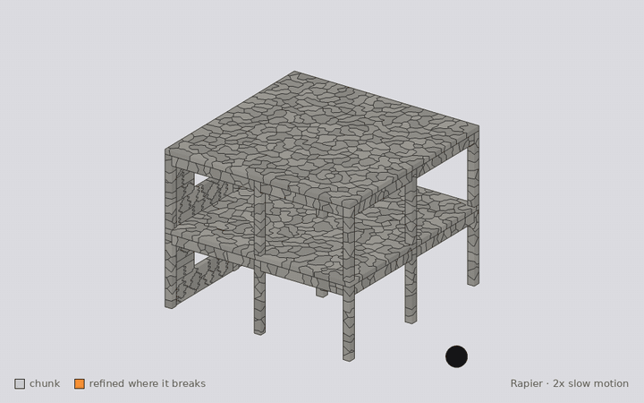
  <br>
  <sub>A two-storey building baked in 28 s, then simulated in <a href="https://rapier.rs">Rapier</a>. A stress solver on Shardwright's bonds decides what breaks. Chunks are refined into finer cells (orange) only where they are hit. Half speed; <a href="#at-runtime-break-only-where-it-breaks">how it works</a>, <a href="docs/readme/collapse_two_storey.mp4">MP4 with counters</a>.</sub>
</p>

`prefracture` is an offline Rust library and CLI. It takes a glTF/OBJ/PLY/STL
scene plus optional authoring metadata, and bakes it into:

* a **glTF render payload** (`.glb`): one node per fragment, with shared
  interior surfaces, chipping, triplanar interior UVs, LODs (`MSFT_lod`),
  meshopt compression and rebar stubs;
* a **physics payload** (`.fracphys`, FlatBuffers, [`schemas/frac.fbs`](schemas/frac.fbs)
  with [TypeScript bindings](schemas/ts/frac)), containing:
  * the fragment hierarchy and exact mass properties;
  * non-overlapping convex hulls;
  * a bond graph with exact contact geometry and strengths at every level;
* a **report** (`.report.md` / `.report.json`): hard gates, quality metrics and stage timings.

## TL;DR

**The problem.** Pre-fractured destruction in games, simulation and film is
usually a random Voronoi shatter. Cracks land anywhere, glass and brick
break the same way, pieces glue parts together, and nothing tells the
physics what holds what. The result looks fake, and the solver can't tell
what should break.

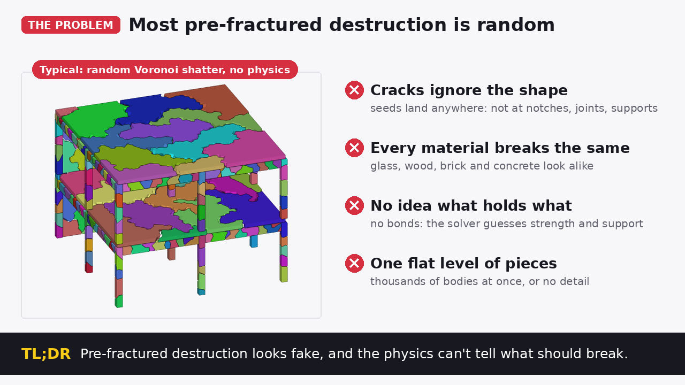

**The pitch.** You author the structure and its materials. Shardwright bakes
it into everything a destruction runtime needs:

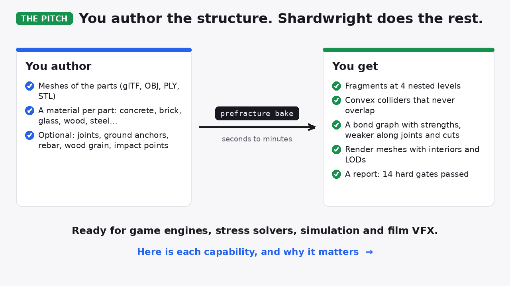

What makes those outputs different:
* pieces that break where the real object would, from fracture modes and
  material-specific fracture patterns;
* convex colliders that never overlap;
* an exact bond graph for your stress solver, weaker along joints and
  structural cuts;
* a four-level hierarchy that adds detail only where something breaks.

All of it is cut from one exact cell complex, so fragments, colliders and
bonds always agree, and every bake is checked against hard gates and
physics oracles.

## Contents

[Why Shardwright?](#why-shardwright) ·
[The evidence](#the-evidence) ·
[Your inputs](#what-you-author-and-how-it-changes-the-result) ·
[Built on proven ideas](#built-on-proven-ideas-improved-for-destruction) ·
[Gallery](#gallery) ·
[How it works](#how-it-works) ·
[Stress-solver support graph](#a-support-graph-for-stress-solvers) ·
[Quick start](#quick-start) ·
[Use as a library](#use-as-a-library) ·
[Configuration](#configuration) ·
[Quality and validation](#quality-and-validation) ·
[Performance](#performance) ·
[Setup](#setup) ·
[Repository layout](#repository-layout) ·
[References](#references)

## Why Shardwright?

<p align="center">
  
  <br>
  <sub>The explainer, about two minutes (<a href="docs/readme/why_shardwright.mp4">MP4 version</a>). Every number in it is measured; see <a href="#the-evidence">the evidence</a> below.</sub>
</p>

| | Typical uniform shatter | Shardwright |
|---|---|---|
| **Where it cracks** | Random seeds, the same everywhere | Fracture modes (Sellán et al. 2023) find the cuts that need the least energy; joints between parts break first |
| **Materials** | One pattern for everything | Material recipes: radial glass, tempered dicing, wood grain, masonry along mortar, stone bedding, clustered concrete, drywall panels, ceramic, steel |
| **Structure** | One flat level of pieces | Four nested levels (component → structural → chunk → cell), each a complete partition with parent/child links |
| **Connectivity** | Adjacency at best | Exact bonds: area, centroid, normal, frame, second moments, composition, rebar crossings, joint kind, Weibull strength, ground anchors |
| **Colliders** | Per-piece hulls that can overlap | Convex hulls of at most 64 vertices that never overlap between neighbours, with convex decomposition (a pure-Rust CoACD port) where needed |
| **Rendering** | Flat interior faces | Shared displaced interiors, chipping, triplanar UVs, LODs, watertight between fragments |
| **Trust** | Inspect by eye | 14 hard gates on every bake, oracles (FEM, Voro++, upstream CoACD, the fracture-modes authors' code), byte-identical output across thread counts and operating systems |

**Use it if you are**
- building destruction for a game or simulation and want pieces that break believably and stay cheap at runtime;
- feeding a **stress solver** (a support graph of chunks and bonds, as NVIDIA Blast-style solvers use) and need physically meaningful bond areas and strengths instead of guesses;
- shipping to a rigid-body engine (PhysX, Jolt, Rapier, Havok, …) and need valid compound colliders with exact mass properties;
- making film or VFX destruction and want physically plausible breakage from authored structure and materials, instead of hand-placed cuts;
- running a content pipeline that must be reproducible: the same input and settings give the same bytes.

## The evidence

Each claim below compares Shardwright with a **uniform baseline**: the same
pipeline and the same meshes, with an isotropic Voronoi recipe on every part
and geometry-only clustering in place of fracture modes. That is the
"random seeds everywhere" approach most tools use. The scripts that produce
every number and image are in [`tools/explainer/`](tools/explainer/).

### Why fracture modes instead of random seeds?

Look at each input below and you can tell where it will break: the
bracket at its neck, the bone across its shaft, the creature at its slender
arms, the chair at its legs. Random Voronoi seeds can't see any of that.
They cut wherever they land, so a stress solver never gets the break you
expected. Fracture modes ([Sellán et al. 2023](#references)) solve an FEM
model of the shape for the cuts that need the least energy, which are
exactly those weak points.

<p align="center">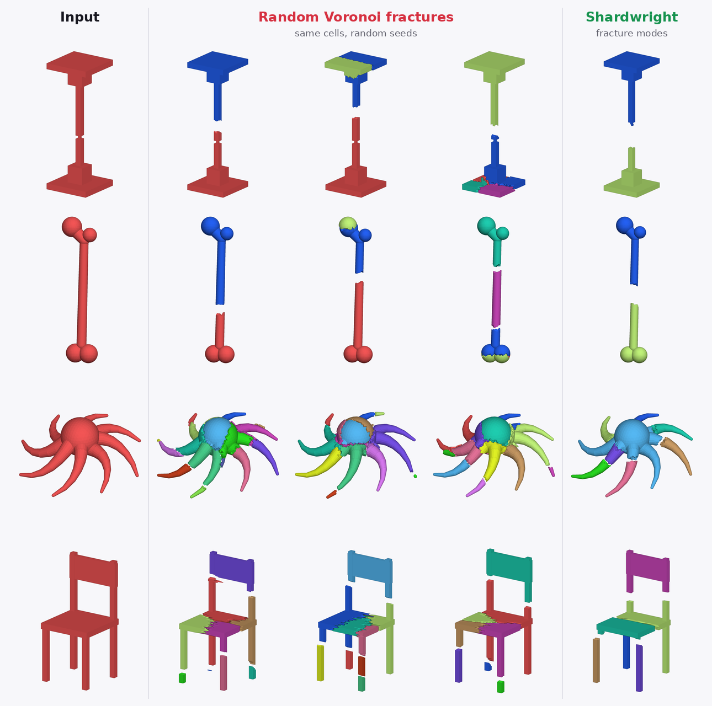</p>

<sub>Every column uses the same baked cells. The random columns group them by
nearest random seed; the Shardwright column is the bake's Level 1 (2 pieces
for the bracket and bone, 9 for the creature, 6 for the chair). The models
are procedural, after the paper's figures (`tools/explainer/models.py`).</sub>

This also holds up against an FEM crack oracle. On the
reinforced-concrete column:
* the lowest-energy mode detaches the column at its anchored root;
* the crack oracle (Kratos FEM, 9 load cases) cracks it there in 5 of 9
  cases;
* the column's 12 structural fragments recover 26% of the oracle's crack
  surface, against 20% for the uniform baseline. About 45% is the most any
  12-piece split can reach at that resolution
  ([details](docs/VALIDATION.md#crack-placement-spec-134--rankine-oracle)).

### Why does each material need its own fracture pattern?

Materials fail differently, and players notice:
* **Annealed glass** cracks radially from the impact.
* **Tempered glass** is pre-stressed, so it dices into small cubes.
* **Wood** splinters along its grain into long, thin pieces.
* **Masonry** fails at the mortar.

A single Voronoi pattern gets all four wrong.

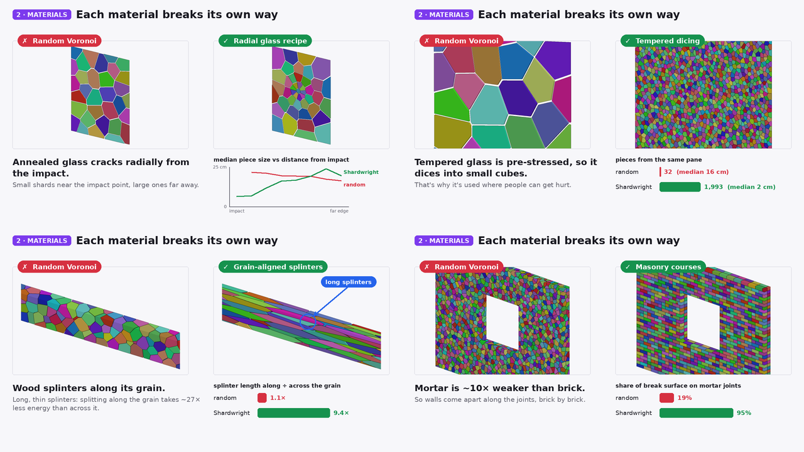

| Material | What the physics says | Uniform baseline | Shardwright |
|---|---|---|---|
| Annealed glass | small shards near the impact, large far away | about 17–22 cm everywhere | **7 cm near the impact, 20–25 cm far from it** |
| Tempered glass | dices into small pieces | 32 pieces, median 16 cm | **1,993 pieces, median 2 cm** |
| Pine (splinters) | splitting along the grain takes ~27× less energy than across it, so it splinters | blobs, 1.2× longer along the grain | **long splinters, 9.4× longer along the grain** |
| Brick wall | mortar is ~10× weaker than brick | 19% of break surface on mortar joints | **95% on mortar joints** |

The material ratios come from the built-in library
([`materials.toml`](crates/frac-material/materials.toml)); the shapes are
measured on the baked cells.

### Why should the same tool output the bonds?

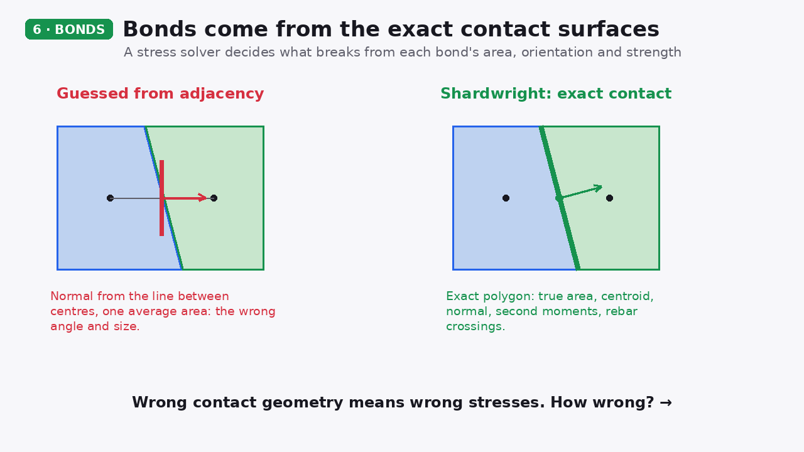

A stress solver decides what breaks from each bond's area, orientation and
strength. If a separate tool only knows *which* pieces touch, it has to
guess the rest. To measure what those guesses cost, we ran the same solver
on the same 1,537 pieces. The test applies a uniform stress, so the exact
answer is known.

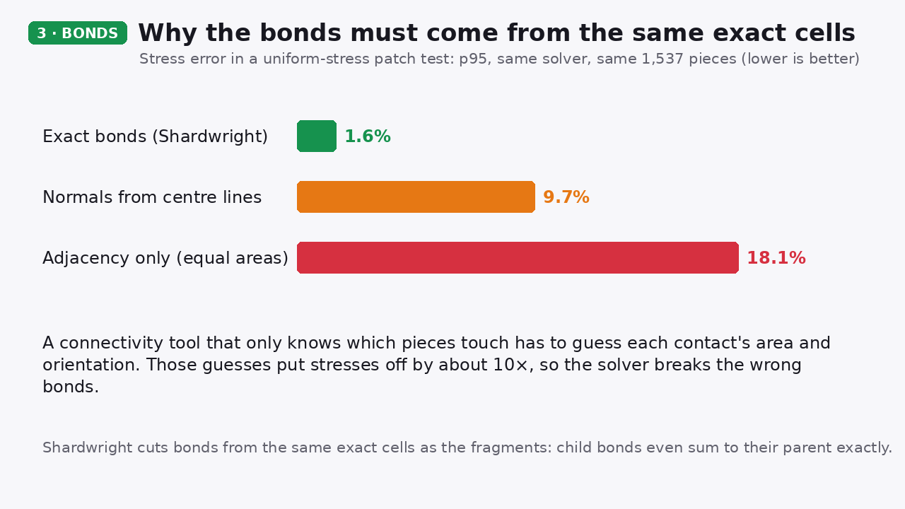

| Bond data | Stress error (p95) |
|---|---|
| **Exact bonds (Shardwright)** | **1.6%** |
| Normals and centroids from the line between piece centres | 9.7% |
| Adjacency only (equal areas) | 18.1% |

Shardwright cuts bonds from the same exact cells as the fragments, so they
match by construction; child bonds even sum exactly to their parent. On
top of that, bonds on predefined cuts are deliberately weaker, so the solver
breaks along them first ([support graph](#a-support-graph-for-stress-solvers)).
You can reproduce the test with `cargo run --release -p frac-pipeline --example bond_geometry -- <asset.json>`.

What a solver gets from the bonds, on the two-storey building:

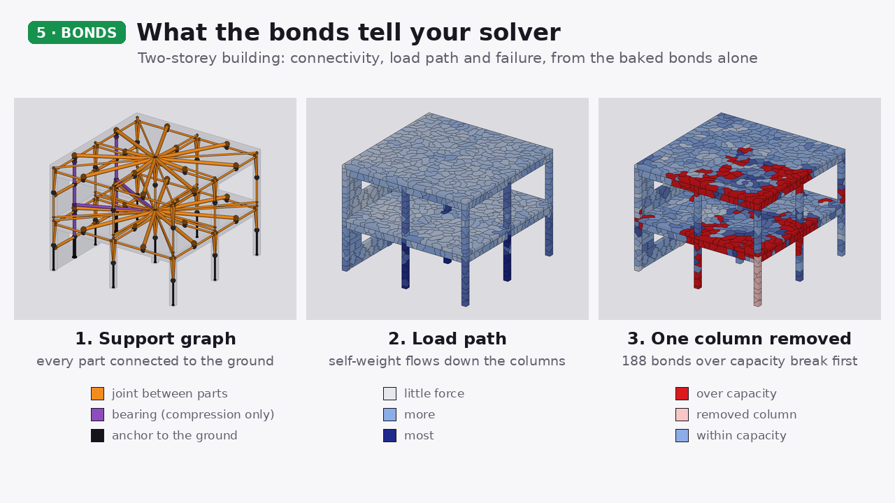

1. **Support graph.** Every part is a node and every bond an edge, drawn
   through the contact it stands for. Each piece reaches the ground through
   some path, so nothing floats.
2. **Load path.** An exact stress solve of all 3,657 chunk bonds under
   self-weight. The ground-floor columns carry the building; the slabs carry
   little.
3. **One column removed.** Take out the column the wrecking ball hits (see
   [at runtime](#at-runtime-break-only-where-it-breaks)) and 188 bonds go
   over capacity. Those break first, and that is where the simulated
   collapse starts.

`tools/explainer/support.sh` reproduces the three views. The loads come
from `frac-sim --analyze` ([tools/sim](tools/sim/README.md)), and
`prefracture preview --graph` draws the graph.

### Why decompose into convex hulls?

Physics engines collide convex shapes, but fracture-mode pieces follow the
object's shape, so they are non-convex. Shardwright decomposes every piece
at every level into convex hulls of at most 64 vertices, with a pure-Rust
port of CoACD. Convex cells skip this step, and the hulls of neighbouring
pieces never overlap (see [colliders](#why-non-overlapping-colliders)).

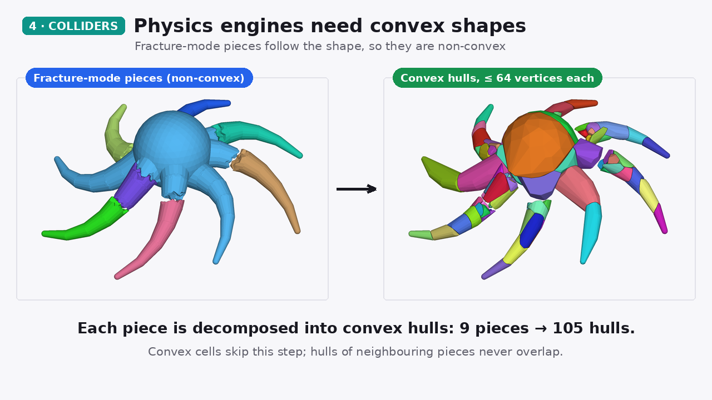

### Why a hierarchy?

A flat shatter forces a choice: thousands of rigid bodies at once, or no
detail. Shardwright's four nested levels let a runtime swap a fragment for
its children only where it breaks. For the same local damage to the
two-storey building that takes **324 bodies instead of 6,860 (21× fewer)**
(the `preview --impact` partial break).

In the [Rapier simulation](#at-runtime-break-only-where-it-breaks), the
collapsing building is 1,295 bodies two seconds in. Only the 240 chunks that
were hit have been refined into finer cells:

<p align="center">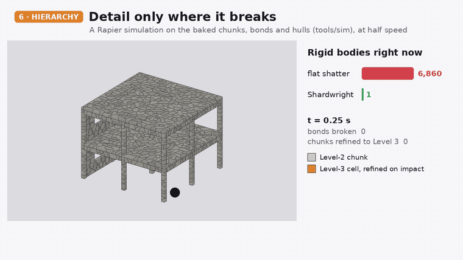</p>

### Why non-overlapping colliders?

When two neighbouring pieces spawn with overlapping hulls, the physics
engine pushes them apart, and the pieces pop and jitter. Shardwright
separates neighbouring hulls with a plane plus a margin, and a hard gate
checks it on every bake. Against upstream CoACD at the same hull budget,
the hulls also fit tighter:

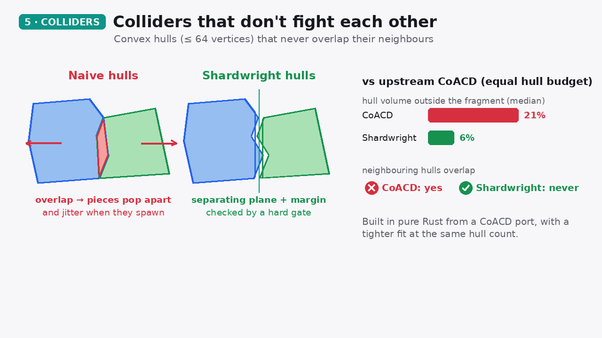

| At equal hull budget | Upstream CoACD | Shardwright |
|---|---|---|
| Hull volume outside the fragment (median) | 21% | **6%** |
| Neighbouring hulls overlap | yes | **never** |

### How do we know it's right?

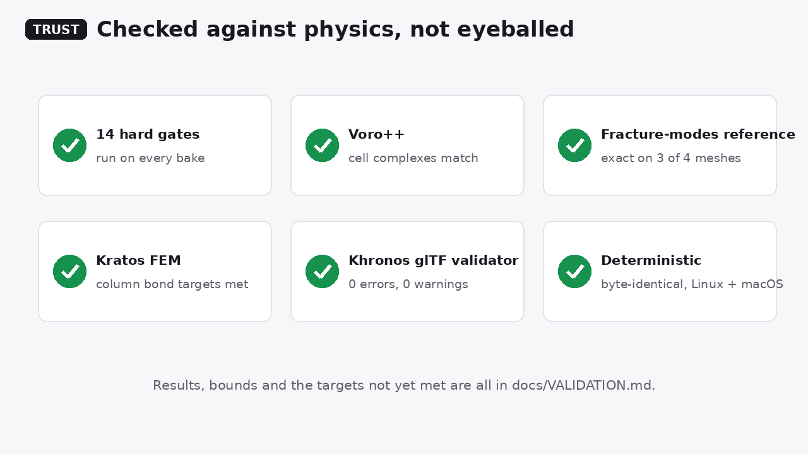

Every bake runs [14 hard gates](#quality-and-validation). The pipeline is
also checked against independent references:
* Voro++;
* the fracture-modes authors' reference code;
* Kratos FEM;
* upstream CoACD;
* the Khronos glTF validator.

[`docs/VALIDATION.md`](docs/VALIDATION.md) records every result, including
the targets not yet met and the bounds on them.

## What you author, and how it changes the result

You model the structure and choose materials; Shardwright does the rest.

| You author | Required | Example |
|---|---|---|
| Meshes of the parts (glTF, OBJ, PLY, STL) | yes | a building as walls, slabs, beams, columns |
| A material per part | yes (default library) | `"material": "brick_clay"` |
| Joints between parts | optional | `{"a": "wall", "b": "column", "kind": "mortar_joint"}` |
| Ground anchors, rebar, wood grain, impact points | optional | `"anchor": true`, `"grain": [1, 0, 0]` |

Change one line of a part's metadata, re-bake, and the result follows it:

<p align="center">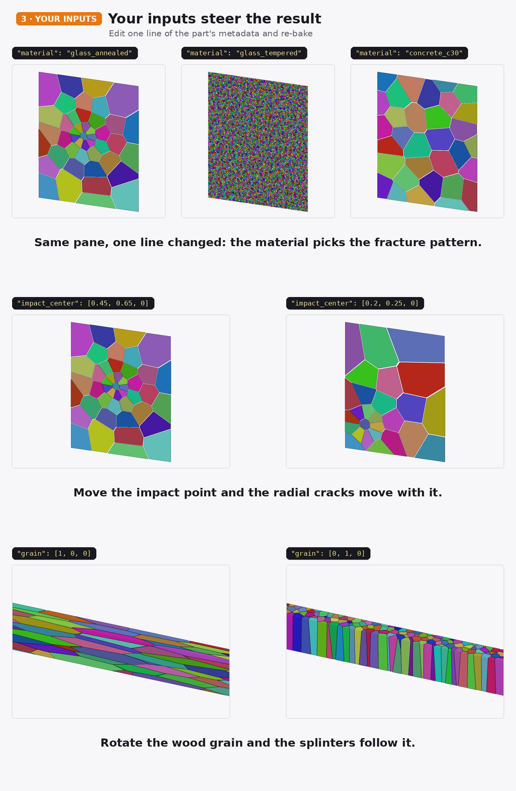</p>

Each material property drives a specific part of the result:

| Material property | Drives |
|---|---|
| `recipe`, grain, masonry layout, impact point | the cell pattern: how it shatters |
| Young's modulus, Poisson's ratio | fracture modes (FEM) and bond stiffness |
| fracture energy (along / across the grain, at joints) | where cuts are cheap, so where it splits |
| tensile and compressive strength, cohesion | bond capacity for the stress solver |
| Weibull modulus | size-effect weakening of large cut surfaces |
| density | mass and inertia of every piece |
| noise profile, chipping ratio, interior colours | the render meshes |

The built-in library is [`materials.toml`](crates/frac-material/materials.toml);
calibrate it, or pass your own with `--materials`.

## Built on proven ideas, improved for destruction

None of the individual techniques is new. What Shardwright adds is one
consistent chain, built from one exact cell complex, with each step
improved for destruction:

| Technique | Builds on | What Shardwright adds |
|---|---|---|
| Voronoi fracture | classic | material recipes (radial glass, tempered dicing, wood grain, masonry courses, stone bedding), exact clipping to the solid |
| Fracture modes | [Sellán et al. 2023](#references) | weakest cuts first (energy-weighted segmentation), material-aware weights, an open-source solver (Clarabel), building scale |
| Convex decomposition | [CoACD](#references), Wei et al. 2022 | pure Rust, neighbours never overlap, tighter fit at the same hull count (6% vs 21% outside volume) |
| Stress-solver bonds | support graphs, e.g. NVIDIA Blast | exact contact geometry (about 10× lower stress error), Weibull size-effect weakening on joints and cuts |
| Hierarchy | chunk hierarchies, e.g. Blast | four nested levels with consistent bonds, detail only where it breaks |
| Validation | — | 14 hard gates, FEM / Voro++ / CoACD oracles, byte-identical builds |

## Gallery

Each material gets its own fracture pattern, and structures split where
they are weakest. Everything below comes from the benchmark suite, and every
bake passes all hard gates.

<p align="center">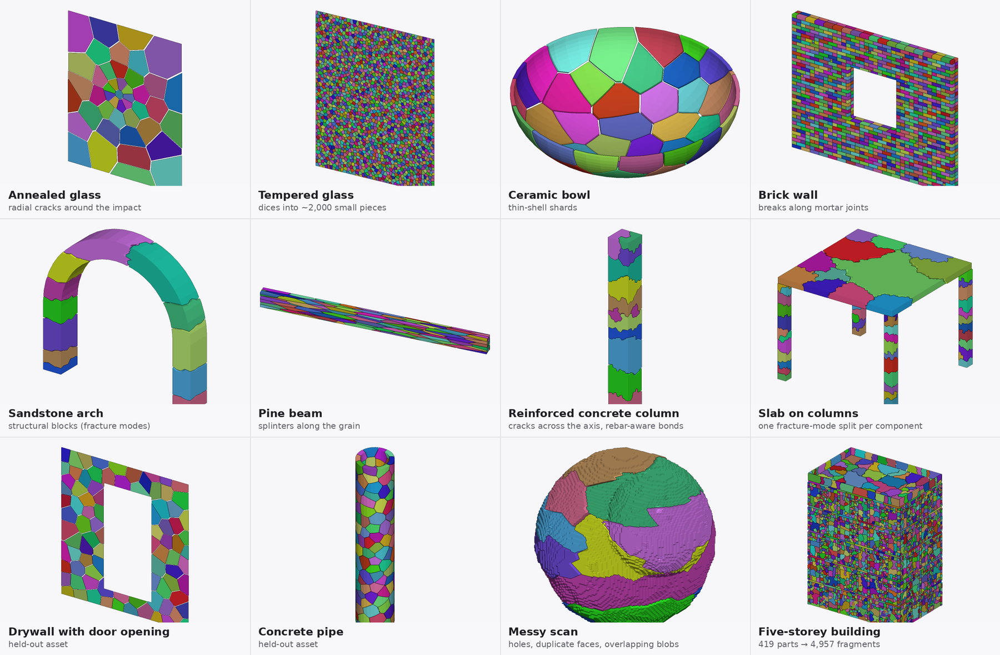</p>

**Masonry breaks into brick clusters.** Structural fragments follow the
mortar joints, L2 chunks are clusters of whole bricks, and the leaf cells are
individual bricks:

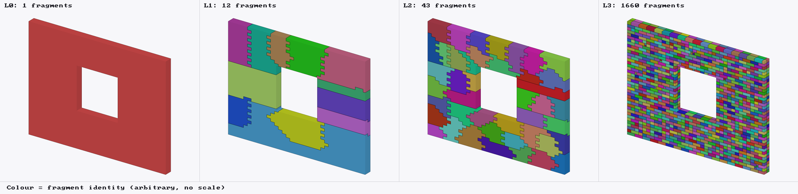

**It scales to whole buildings.** A five-storey frame with 419 authored parts
(concrete, brick, drywall and glass) bakes in 94 s:

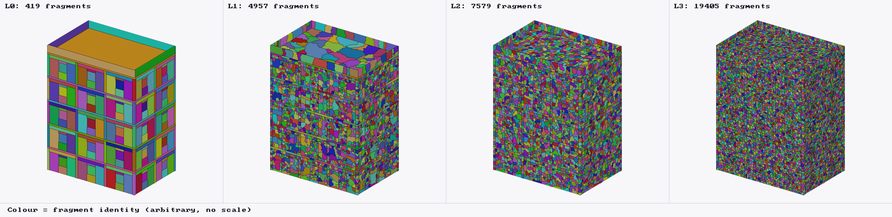

More previews are in [`docs/previews/`](docs/previews/).

## How it works

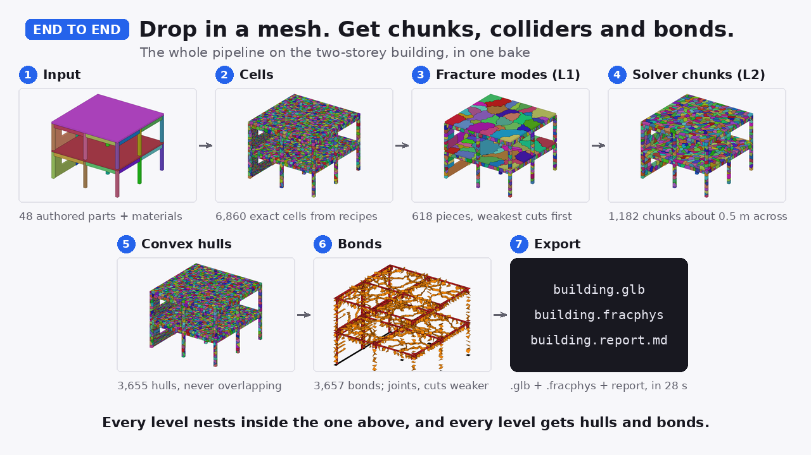

The levels are nested refinements of **one** set of exact cells, not
separate fracture passes:
1. the material recipes cut each part into small convex cells (L3);
2. fracture modes group cells into structural pieces (L1);
3. L2 clusters the cells of each L1 piece into solver chunks;
4. every piece at every level then gets convex hulls and bonds.

So L1 and L2 pieces can be non-convex (several hulls each), while L3
cells are almost always one hull.


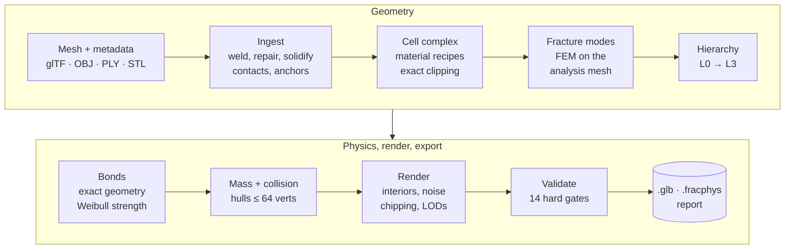

1. **Ingest** welds and repairs the input, solidifies open or self-overlapping
   scans, finds contacts between parts, and anchors parts to the ground.
2. **Cells.** Each part is split into a cell complex by its material's
   recipe (for example radial glass, brick courses or wood grain), clipped to
   the solid with an exact symbolic geometry kernel. Cell volumes sum to the
   part's volume to 1e-14.
3. **Fracture modes.** These follow Sellán et al., *Breaking Good*: an FEM
   analysis on a coarser analysis mesh. Level 1 is segmented by
   energy-weighted jumps, so the weakest cuts come first (a column breaks at
   its anchored root).
4. **Hierarchy.** Each level is a union of the next finer one. On the
   two-storey building, 48 authored parts become 618 structural fragments,
   then 1,182 solver chunks, then 6,860 convex cells:

   <p align="center">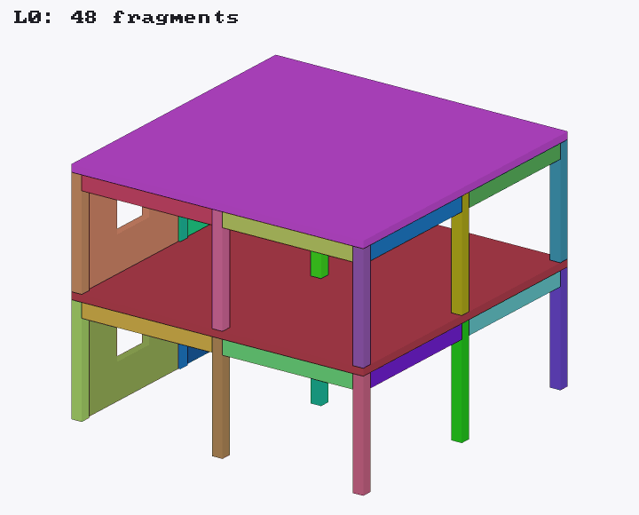</p>

   ```mermaid
   flowchart TD
       L0["<b>L0 · components</b><br/>authored parts: wall, slab, column"] --> L1["<b>L1 · structural fragments</b><br/>fracture modes, weakest cuts first"]
       L1 --> L2["<b>L2 · chunks</b><br/>the stress solver's graph"]
       L2 --> L3["<b>L3 · cells</b><br/>convex leaf pieces / debris"]
   ```

5. **Bonds.** Every contact between two fragments at every level becomes a
   bond. A bond records:
   * its exact area, centroid, normal and frame;
   * its second moments, which give bending and torsion stiffness;
   * its material composition and rebar crossings;
   * its joint kind (monolithic, mortar, cold joint, weld, bearing, …);
   * a Weibull strength scale.

   Child bonds sum exactly to their parent (`bond_hierarchy` gate).
6. **Collision.** Convex fragments get one hull. Others are decomposed by
   a CoACD port, with at most 64 vertices per hull and separating planes
   between neighbours.
7. **Render** builds displaced interior surfaces shared by both sides of a
   crack, so there are no gaps, plus chipping, UVs and LODs.
8. **Validate and export.** Every bake runs the hard gates and writes the
   payloads with deterministic ordering.

### At runtime: break only where it breaks

Every fragment at every level can be a rigid body with its own compound
collider. A runtime starts coarse and swaps a broken fragment for its
children only where it broke, so distant parts stay cheap.

The hero animation at the top is this in practice: a wrecking ball through
the two-storey building in [Rapier](https://rapier.rs), at half speed.
Below is the impact from a low camera. The demo is in
[`tools/sim`](tools/sim/README.md); `tools/sim/make.sh` reproduces it.

* It starts from the 1,182 Level-2 chunks. Chunks joined by intact bonds
  move as one rigid body.
* A stress solver on the baked bonds breaks bonds when their force or moment
  exceeds their capacity.
* The ball breaks a column. The first floor loses support and comes down,
  and the roof follows it.
* Chunks are refined to Level-3 cells (orange) only where they are hit.

<p align="center">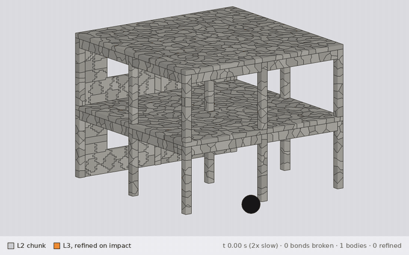</p>
<p align="center"><sub>Grey: Level-2 chunks. Orange: Level-3 cells refined on impact. The strip shows bonds broken, rigid bodies and refined chunks. The wide shot with counters is the <a href="docs/readme/collapse_two_storey.mp4">MP4</a>.</sub></p>

The `prefracture preview --impact` view shows the same idea without physics:
fragments near an impact are replaced by progressively finer levels.

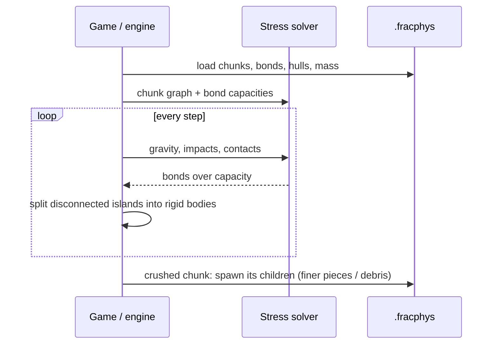

## A support graph for stress solvers

With [`support_clusters.toml`](benchmarks/configs/support_clusters.toml), L2
is the stress solver's graph, sized for runtime cost. Chunks are about 0.5 m
across (`[hierarchy] level2_extent`):

* small fragments stay one chunk;
* floors are split by footprint;
* masonry forms brick clusters.

The L3 cells under each chunk are its convex debris.

What the graph looks like, and what a solver gets from it, on the two-storey
building:

<table>
  <tr>
    <td width="50%">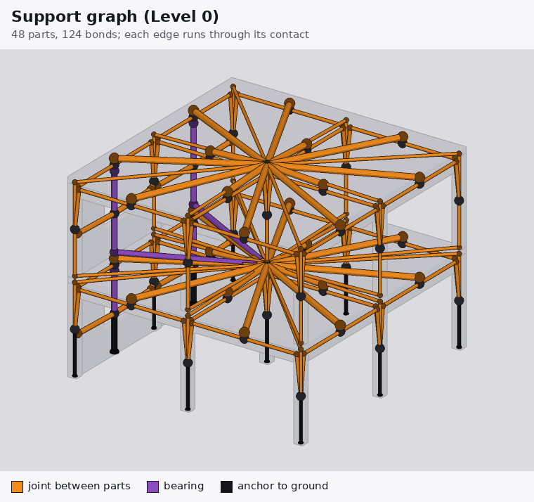</td>
    <td width="50%">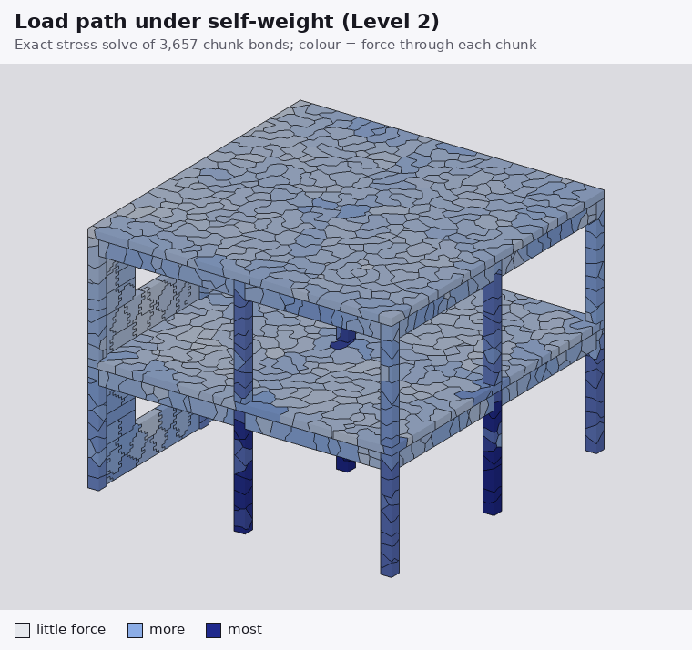</td>
  </tr>
  <tr>
    <td><b>Connectivity.</b> Every part is a node, every bond an edge through the contact it stands for. Every piece reaches the ground (black anchors) through some path.</td>
    <td><b>Load path.</b> An exact stress solve of all 3,657 chunk bonds under self-weight. The ground-floor columns carry the building; the slabs carry little.</td>
  </tr>
</table>

**What fails if a column goes?** Remove each ground-floor column in turn and
re-solve: the red chunks have bonds over capacity and break first. The
three columns along the brick infill wall overload only 2 to 10 bonds (the
wall can take over their load); the centre column overloads 886. The last
frame is the column the wrecking ball hits in the
[simulation](#at-runtime-break-only-where-it-breaks), and its 188 overloaded
bonds are where that collapse starts:

<p align="center">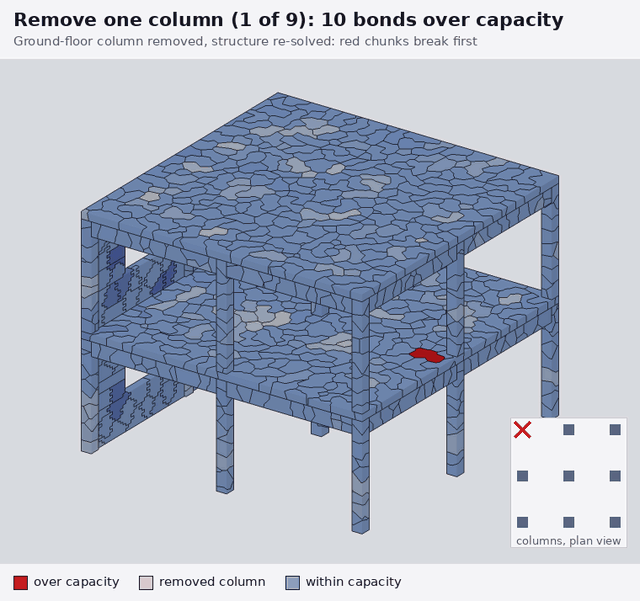</p>

`tools/explainer/support.sh` reproduces these views (loads from
`frac-sim --analyze` in [tools/sim](tools/sim/README.md), drawn with
`prefracture preview --graph` and `--sim`).

The important part is **where the solver should break**. A chunk bond on a
predefined boundary is weaker than one inside a fragment. The boundaries are
cuts between structural fragments (L1) and joints between authored parts
(L0). Two principled terms make those bonds weaker:

* **Weibull weakest-link size effect** (`[bonds] size_effect`): a bond on a
  coarser boundary takes the strength of that whole surface,
  `(A_surface / A_ref)^(-1/m)`, using the material's Weibull modulus `m`.
* **Configurable bias** (`[bonds] boundary_factors = [L0 joints, L1 cuts]`,
  default `[0.5, 0.4]`, plus `anchor_factor`), so you can tune how strongly
  the solver prefers the predefined cuts.

On the two-storey building, L1-cut bonds end up at **×0.37** and part joints at
**×0.13** of the interior median capacity:

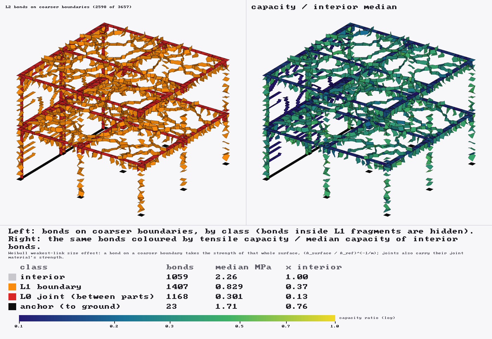

Bonds also carry their joint kind, so the solver can treat mortar, cold
joints, bearings (compression only) and ground anchors differently:

<p align="center">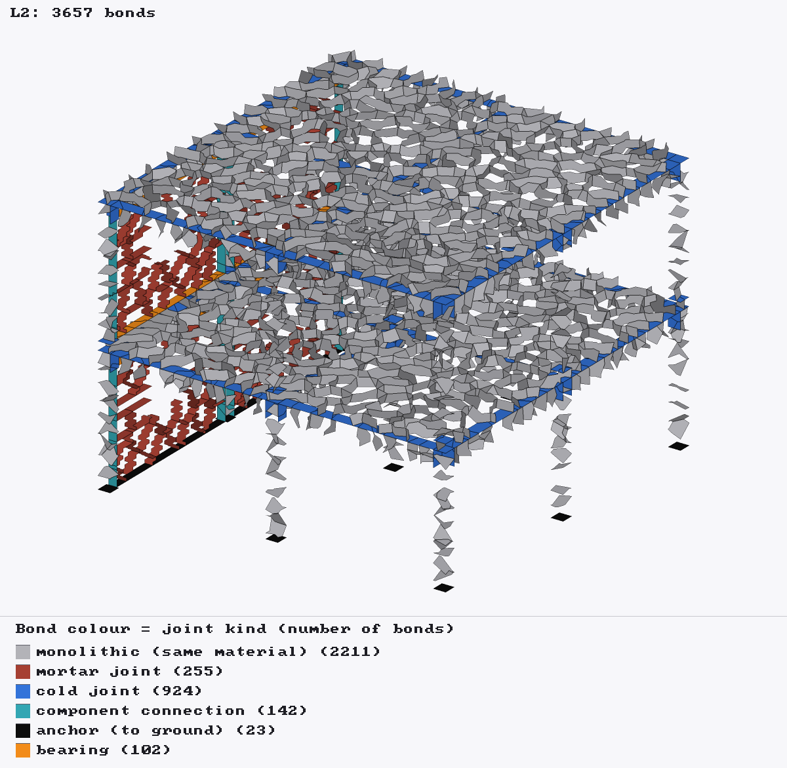</p>

| Asset (support_clusters.toml) | L0 | L1 | L2 chunks | L3 cells | Time |
|---|---|---|---|---|---|
| two_storey_building | 48 | 618 | 1,182 (3.1 hulls each) | 6,860 | 28 s |
| brick_wall_window | 1 | 12 | 43 brick clusters | 1,660 | 8 s |
| building_v0 | 132 | 1,545 | 2,302 | 5,956 | 31 s |
| building_v1 | 419 | 4,957 | 7,579 | 19,405 | 94 s |

## Quick start

```sh
cargo build --release
B=./target/release/prefracture

# preview the input, bake it, preview the result
$B preview --input benchmarks/assets/rc_column.glb --out out/rc_column_input.png
$B bake    --input benchmarks/assets/rc_column.glb --config benchmarks/configs/bake.toml --out out/
$B preview --input out/rc_column.asset.json --out out/rc_column.png --all-levels
```

The sidecar `<input>.meta.json` is picked up automatically. `bake` writes:

| File | Contents |
|---|---|
| `rc_column.glb` | render payload, one node per fragment at every level |
| `rc_column.fracphys` | physics payload: hierarchy, mass, hulls, bonds |
| `rc_column.asset.json` | the full baked asset, for tooling and previews |
| `rc_column.report.md` / `.report.json` | gates, metrics, stage timings |

**Previews.** `prefracture preview` is a deterministic software rasterizer.
Every image includes a legend, and a new file is numbered instead of
overwriting an old one.

```sh
$B preview --input X.asset.json --out X.png --all-levels [--max-level 2]     # every level side by side
$B preview --input X.asset.json --out X.png --level 1 --explode 0.12         # exploded view
$B preview --input X.asset.json --out X.png --level 2 --bonds kind           # joint kinds
$B preview --input X.asset.json --out X.png --level 2 --bonds strength       # tensile capacity, MPa
$B preview --input X.asset.json --out X.png --bonds weakening                # boundary weakening
$B preview --input X.asset.json --out X.png --impact 4.1,3.3,8.2 --radius 3 --explode 0.6   # partial break
```

**Other commands.**

```sh
$B bake ... --check-determinism                      # bake twice, require identical bytes
$B validate --input out/rc_column.asset.json --oracle-cache /tmp/oracle   # FEM bond-fidelity oracle
$B inspect --input out/rc_column.fracphys
$B diff --a out/a --b out/b                          # byte and metric diff of two output dirs
$B decompose ...                                     # stand-alone CoACD-port convex decomposition
$B patterns --out patterns.fracpat                   # runtime fracture-pattern library
$B gen-bench                                         # regenerate benchmarks/assets
```

### Authoring metadata

Metadata is optional. It goes in the `<input>.meta.json` sidecar (or TOML),
or in glTF `extras.prefracture`. The `"*"` key applies to every part.

```json
{
  "parts": {
    "*":        { "material": "concrete_c30" },
    "column":   { "component_role": "column", "anchor": true,
                  "rebar": [{ "points": [[-0.15, 0, -0.15], [-0.15, 3, -0.15]], "diameter": 0.02 }] },
    "wall":     { "material": "brick_clay" },
    "window":   { "material": "glass_annealed", "impact_center": [1.2, 1.5, 0.0] }
  },
  "connections": [{ "a": "wall", "b": "column", "kind": "mortar_joint" }],
  "ground_height": 0.0
}
```

Part options include:
* `material` and `material_map`;
* `recipe`, `masonry_layout`, `grain` and `impact_center`;
* `anchor` and `anchor_below`;
* `rebar`;
* `density_boxes` and `forbidden_zones`;
* `group`;
* per-part cell densities.

Connection kinds are `weld`, `bolted`, `mortar_joint`, `cold_joint`,
`adhesive` and `bearing`.

The built-in material library ([`crates/frac-material/materials.toml`](crates/frac-material/materials.toml))
has `concrete_c30`, `brick_clay`, `pine`, `glass_annealed`, `glass_tempered`,
`drywall`, `steel_s355`, `sandstone` and `ceramic`, plus joint materials. Its
values are illustrative: calibrate them per project with `--materials your.toml`.

## Use as a library

The workspace is a set of focused crates. `frac-pipeline` runs the whole bake,
and every stage (`frac-cells`, `frac-modes`, `frac-bonds`, `frac-collision`, …)
is usable on its own. This is [`crates/frac-pipeline/examples/bake.rs`](crates/frac-pipeline/examples/bake.rs):

```rust
use frac_core::input::AuthoringMeta;
use frac_core::{FragmentOrWorld, Settings};
use frac_material::MaterialLibrary;
use frac_pipeline::{InputSpec, run};

let settings = Settings::from_toml(&std::fs::read_to_string("benchmarks/configs/bake.toml")?)?;
let lib = MaterialLibrary::builtin();
let opts = frac_io::ImportOptions { unit_scale: settings.ingest.unit_scale, z_up: settings.ingest.z_up };
let spec = InputSpec {
    name: "rc_column".into(),
    scene: frac_io::load_scene("benchmarks/assets/rc_column.glb".as_ref(), &opts)?,
    meta: AuthoringMeta::from_json(&std::fs::read_to_string("benchmarks/assets/rc_column.glb.meta.json")?)?,
    variant: 0,
};

let res = run(&spec, &settings, &lib)?;      // res.gltf, res.physics: payload bytes
let a = &res.asset;                          // the typed asset: hierarchy, bonds, hulls
for level in 0..a.hierarchy.levels {
    let bonds: Vec<_> = a.bonds.iter().filter(|b| b.level == level).collect();
    let anchors = bonds.iter().filter(|b| matches!(b.b, FragmentOrWorld::World)).count();
    println!("L{level}: {} fragments, {} bonds ({anchors} to the ground)",
             a.level_fragments(level).len(), bonds.len());
}
```

```text
$ cargo run --release -p frac-pipeline --example bake -- benchmarks/assets/rc_column.glb benchmarks/configs/bake.toml out/
L0: 1 fragments, 1 bonds (1 to the ground)
L1: 12 fragments, 16 bonds (1 to the ground)
L2: 96 fragments, 418 bonds (7 to the ground)
L3: 1537 fragments, 9494 bonds (36 to the ground)
hard gates failed: []
```

On the runtime side, read `.fracphys` with any FlatBuffers implementation.
TypeScript bindings are generated in [`schemas/ts/`](schemas/ts/frac).

## Configuration

Settings are TOML. Every field has a default, so a config only lists what it
changes. The configs in [`benchmarks/configs/`](benchmarks/configs/):

| Config | Use it for |
|---|---|
| `bake.toml` | Spec defaults with fracture modes; fine cells (8.5 cm) for component-scale assets. |
| `support_clusters.toml` | **Recommended for stress solvers.** Four levels with L2 as ~0.5 m solver chunks, boundary-weakened bonds and L3 convex debris (see [above](#a-support-graph-for-stress-solvers)). |
| `support_graph.toml` | Three levels: every chunk is one exact convex Voronoi cell (one hull, planar bonds), plus optional `[debris] pieces` per chunk. On the two-storey building: 11,270 chunks at 1.01 hulls each, 64 s. |
| `building.toml` | Every quality feature (modes, noise, chipping, 3 LODs, CoACD hulls) with cells sized for multi-storey buildings (~29 cm analysis, ~18 cm fine cells). |
| `building_lite.toml` | Quick starter for buildings: no modes, no noise, one LOD. |
| `fast.toml` | No fracture modes; agglomeration for Level 1. |
| `ablation_*.toml` | The geometric-only and fallback ablations. |

Key knobs:

| Setting | Effect |
|---|---|
| `levels` | 3 or 4 hierarchy levels |
| `[cells] max_chunk_extent` | Chunk size by extent (m): thin, wide parts get footprint-sized chunks |
| `[modes] target_level1_fragments`, `max_fragment_extent` | How many structural fragments, and how large they may be |
| `[hierarchy] level2_extent` | Size of L2 solver chunks (m) |
| `[bonds] size_effect`, `boundary_factors`, `anchor_factor` | Weakening of bonds on predefined boundaries |
| `[collision] max_hulls_per_fragment`, `concavity`, `margin` | Collider budget and accuracy |
| `[render] lods`, `noise`, `chipping` | Render payload detail |
| `seed`, `variants` | Deterministic variation: N different bakes of the same asset |

## Quality and validation

Every bake runs these **hard gates** and fails if one does not pass
(`--allow-gate-failures` to override):

| Gate | Checks |
|---|---|
| `fragment_validity` | every fragment and render mesh is closed and manifold, with no zero-area triangles |
| `volume_conservation` | cell volumes sum to each component's volume (to ~1e-14) |
| `no_overlap_solids` | cells tile the solid exactly |
| `no_overlap_hulls` | neighbouring fragments' hulls do not intersect |
| `collision_shapes` | every hull is convex with at most 64 vertices; every fragment has hulls |
| `structural_support` | every structural component has a load path to the ground |
| `self_weight` | joints carry the structure's own weight within capacity |
| `no_gaps_render` | every interior triangle is matched by its other side |
| `bond_coverage` | every interface has a bond at every level |
| `bond_hierarchy` | child bond areas sum to their parent |
| `mass_properties` | exact mass, centre of mass and inertia, checked against ray casting |
| `slivers` | no cell below the minimum volume or thickness ratio |
| `determinism` | two bakes give identical bytes (`--check-determinism`, CI across thread counts and OSes) |
| `schema` | FlatBuffers verifier, flatc decode, and the Khronos glTF validator with 0 errors and 0 warnings |

**Oracles.** The FEM, crack, Voro++ and fracture-modes answers are frozen as golden datasets and checked in CI:

| Oracle | Result |
|---|---|
| Voro++ | cell complexes match |
| Upstream CoACD (equal hull budget) | coverage 0.974. CoACD reaches 1.000 only by spilling 6.5% of each fragment's volume into its neighbours, against 0.09% for ours. Concavity is better or equal. |
| Authors' fracture-modes code | exact on 3 of 4 reference meshes (0° subspace angles, ARI 1.0) |
| Kratos FEM bond fidelity | all L3 targets met on the reinforced-concrete column; uniform-stress patch tests reproduce to < 1% |
| Rankine crack oracle | L3 crack recall 0.900 |

[`docs/VALIDATION.md`](docs/VALIDATION.md) has the full results, including
the targets not yet met and the bounds on them. [`docs/TESTING.md`](docs/TESTING.md)
covers the test tiers and the golden datasets.

## Performance

`tools/ci/suite.sh [config] [assets...]` bakes the suite and records wall
time, peak RSS and gates against a per-asset budget (`BUDGET_S`, default
300 s). The time covers the whole CLI run: bake, payloads, Khronos glTF
validator, flatc and asset dump. Measured on 4 cores; every asset passes
every gate.

| Asset | Config | Time (s) | Peak RSS (MB) |
|---|---|---|---|
| ceramic_bowl | bake.toml | 5.6 | 70 |
| glass_annealed_pane | bake.toml | 1.0 | 18 |
| glass_tempered_pane | bake.toml | 19.3 | 126 |
| brick_wall_window | bake.toml | 12.7 | 429 |
| rc_column (1537 cells, `fine_per_analysis = 16`) | bake.toml | 7.1 | 194 |
| timber_beam | bake.toml | 3.1 | 83 |
| rc_slab_on_columns | bake.toml | 30.6 | 880 |
| messy_scan | bake.toml | 71.7 | 946 |
| two_storey_building (60,920 cells) | bake.toml | 256.9 | 7,494 |
| held-out: concrete_pipe / drywall_door / stone_arch | bake.toml | 5.7 / 2.0 / 8.7 | ≤ 156 |
| building_v0 (2 storeys, 132 parts) | building_lite.toml | 13.8 | 318 |
| building_v0 (2 storeys, 132 parts) | building.toml | 45.1 | 1,086 |
| building_v1 (5 storeys, 419 parts, 42,547 cells) | building.toml | 139.4 | 3,512 |
| all 14 assets | support_clusters.toml | 0.5 – 93.9 | ≤ 3,187 |

bake.toml and building.toml use a collision budget of 128 hulls per
fragment; the library default is 8.

Two-storey stages with bake.toml:

| Stage | Time |
|---|---|
| cells | 11 s |
| hierarchy with fracture modes | 32 s |
| collision | 41 s |
| render | 39 s |
| validation | 59 s |
| glTF and external validators | ~69 s |

`FRAC_LOG=1` prints per-stage times, sub-stage breakdowns and RSS.

## Setup

```sh
tools/setup.sh              # idempotent: system libs, Rust build, Node glTF validator,
                            # Python oracle env (Kratos, gmsh, scikit-fem, CoACD, ...),
                            # flatc v24.3.25, Voro++ oracle
tools/setup.sh --check      # report what is installed
tools/setup.sh --no-oracles # Rust build + glTF validator only
```

Only Rust is needed to bake. The oracles are for validation and development.

Install locations default to `/opt/fracenv` (Python) and `/opt/oracles`
(flatc, Voro++). Override them with `FRACENV` and `ORACLES`; the CLI and the
tests read the same variables. For Claude Code cloud sessions, set the
environment's *Setup script* to `tools/setup.sh` so every new session starts
fully provisioned.

### Docker

```sh
docker build -t shardwright .
docker run --rm -v "$PWD/out:/work/out" shardwright bake \
    --input benchmarks/assets/rc_column.glb --config benchmarks/configs/bake.toml --out /work/out
```

The image contains the CLI and every oracle: Kratos FEM, CoACD, flatc,
Voro++ and the Khronos validator. Behind a TLS-intercepting proxy, put its CA
certificate in `tools/docker/certs/` and build with
`--network host --build-arg HTTPS_PROXY=…`.

### Oracle environment

The pinned packages are listed in `tools/harness/requirements.txt`:
* Kratos Multiphysics 10.4 with StructuralMechanics and LinearSolvers;
* gmsh;
* scikit-fem;
* scipy;
* coacd;
* manifold3d;
* trimesh.

The harness Python resolves in this order:
1. `PREFRACTURE_PYTHON`;
2. `$FRACENV/bin/python`;
3. `/opt/fracenv/bin/python`.

The glTF gate uses Node with the Khronos validator in `tools/gltf_validate`.

## Repository layout

| Path | Contents |
|---|---|
| `crates/` | the 16 workspace crates, `frac-core` … `frac-cli` (crate map in [`docs/DESIGN.md`](docs/DESIGN.md)) |
| `schemas/` | FlatBuffers schemas (`frac.fbs`, `fracpat.fbs`) and TypeScript bindings |
| `benchmarks/` | benchmark assets (11 + 3 held-out) and configs |
| `tools/harness/` | oracles: Kratos FEM bond fidelity, scikit-fem modal, CoACD differential, Rankine crack oracle |
| `tools/oracles/` | Voro++ differential oracle |
| `tools/gltf_validate/` | Khronos glTF validator wrapper |
| `tools/explainer/` | the comparison bakes, measurements and video behind [the evidence](#the-evidence) (`make.sh`) |
| `tools/ci/` | determinism, golden and suite scripts (determinism also runs in `.github/workflows/ci.yml` on Linux and macOS) |
| `docs/` | [design](docs/DESIGN.md), [validation](docs/VALIDATION.md), [testing](docs/TESTING.md), previews |

[`docs/DESIGN.md`](docs/DESIGN.md) covers the algorithms and every deviation
from the *Pre-Fracture Library — Engineering Spec v1.0* that this library
implements.

## References

- S. Sellán, J. Luong, L. Mattos Da Silva, A. Ramakrishnan, Y. Yang, A. Jacobson. *Breaking Good: Fracture Modes for Realtime Destruction.* ACM Transactions on Graphics, 2023. The fracture-modes stage follows the paper's translational model and matches the authors' reference implementation.
- X. Wei, M. Liu, Z. Ling, H. Su. *Approximate Convex Decomposition for 3D Meshes with Collision-Aware Concavity and Tree Search* (CoACD). ACM SIGGRAPH 2022. `frac-collision` contains a Rust port; see [`THIRD_PARTY_NOTICES.md`](THIRD_PARTY_NOTICES.md).
- C. H. Rycroft. *Voro++: A three-dimensional Voronoi cell library in C++.* Chaos, 2009 (validation oracle).
- Kratos Multiphysics (FEM validation oracle).

## License

Apache-2.0 (see `Cargo.toml`). Third-party notices are in
[`THIRD_PARTY_NOTICES.md`](THIRD_PARTY_NOTICES.md).
